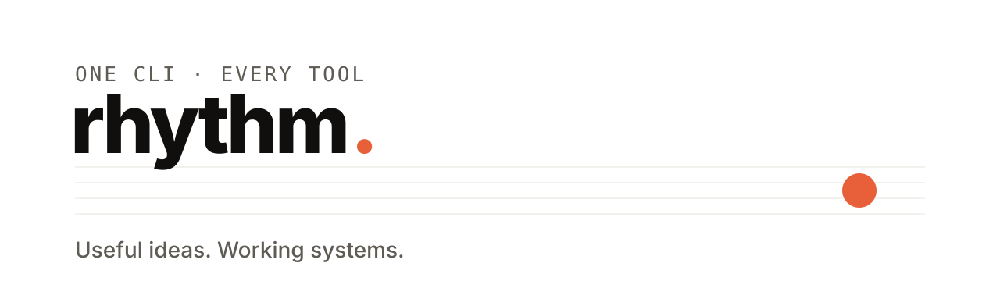

<p align="center">
  <picture>
    <source media="(prefers-color-scheme: dark)" srcset="docs/assets/banner-dark.svg">
    
  </picture>
</p>

<p align="center">
  <b>One CLI for every Rhythm tool.</b><br>
  Install once, then <code>rhythm &lt;tool&gt;</code>. Every tool ships and updates on its own.
</p>

<p align="center">
  <a href="https://github.com/RhythmShahriar/rhythm/releases/latest"></a>
  <a href="https://github.com/RhythmShahriar/rhythm/actions/workflows/ci.yml"></a>
  <a href="LICENSE"></a>
</p>

<br>

## Documentation

Everything about rhythm and its tools lives in the **[documentation wiki](https://github.com/RhythmShahriar/rhythm/wiki)**: installing and updating, every Tuner, Soundcheck and Echo feature, CI, writing checks and the project's policies.

## Install

**macOS · Linux**

```sh
curl -fsSL https://rythm.sh/install | sh
```

**Windows** (PowerShell)

```powershell
irm https://rythm.sh/install.ps1 | iex
```

This installs `rhythm`, Tuner, Soundcheck and Echo to `~/.local/bin` (`/usr/local/bin` as root; `%LOCALAPPDATA%\Programs\rhythm` on Windows, added to your PATH). Every download is checked against the release's `checksums.txt`. When [cosign](https://docs.sigstore.dev/) is installed, or the GitHub CLI and you're logged in, the installer also checks that `checksums.txt` was signed for this repository and tag (see [Verify a release](#verify-a-release)). Then the new `rhythm` checks itself with `rhythm verify rhythm` and every tool it installs.

<details>
<summary>Installer options</summary>

| Variable | Effect |
|---|---|
| `RHYTHM_INSTALL_DIR` | install somewhere else |
| `RHYTHM_VERSION` | install a specific version of rhythm, e.g. `0.5.0` |
| `RHYTHM_TOOLS` | tools to install alongside, separated by spaces or commas (default: the tools rhythm installs on a fresh setup, today `tuner soundcheck echo`). `none` installs no tool. `tool@version` pins one, e.g. `tuner@0.3.1` or `tuner@0.3` for the newest 0.3.x. Every name is checked before any tool is downloaded; a tool that fails doesn't stop the others (the installer then exits 1) |
| `GITHUB_TOKEN` | sent to `api.github.com` only, to lift GitHub's limit of 60 anonymous requests an hour (shared CI runners hit it) |
| `RHYTHM_GITHUB_API` | a GitHub API mirror; it must be `https` (plain `http` only for `127.0.0.1`, `::1` and `localhost`) |
| `RHYTHM_GITHUB_TOKEN` | a token for that mirror; sent to the `RHYTHM_GITHUB_API` host and used instead of `GITHUB_TOKEN` |
| `RHYTHM_SKIP_SIGNATURE` | `1` skips the signature checks, with a warning. Only for a mirror you trust that can't serve the signatures |

```sh
curl -fsSL https://rythm.sh/install | RHYTHM_INSTALL_DIR=/opt/bin RHYTHM_TOOLS=none sh
curl -fsSL https://rythm.sh/install | RHYTHM_TOOLS='tuner@0.3.1,soundcheck' sh
curl -fsSL https://rythm.sh/install | RHYTHM_VERSION=0.5.0 sh
```

```powershell
$env:RHYTHM_TOOLS = 'none'; irm https://rythm.sh/install.ps1 | iex
```

On Windows, `RHYTHM_TOOLS = 'none'` is the way to install no tools: Windows PowerShell 5.1 can't set a variable to an empty value. A pinned older `rhythm` installs the tools it knows and skips the rest with a warning.

</details>

## Tools

Three questions, one for each tool: is my site safe, did my change break anything and is it still saying what it should?

| Tool | What it does | |
|---|---|---|
| **[tuner](https://github.com/RhythmShahriar/tuner)** | Finds what's out of tune in WordPress &amp; PHP sites: leaked secrets, exposed files, known CVEs, weak configuration | `rhythm tuner scan yoursite.com` |
| **[soundcheck](https://github.com/RhythmShahriar/soundcheck)** | Did your change break anything? Snapshots a whole site in a real browser, then shows what broke after an update or deploy: PHP and JS errors, dead buttons, forms, cache leaks, layout and speed | `rhythm soundcheck snapshot yoursite.com` |
| **[echo](https://github.com/RhythmShahriar/echo)** | Is your site still saying what it should? Captures every email, SMS, webhook and API call it sends, seals staging so nothing reaches real people and shows what changed after an update. WordPress, Laravel, Next.js | `rhythm echo up` |

More are on the way. Each lives in its own repository and releases on its own schedule; `rhythm <tool>` runs the `rhythm-<tool>` binary, the same extension model as `git` and `gh`. Any other `rhythm-<name>` program on your PATH runs as `rhythm <name>` too.

## Commands

| Command | What it does |
|---|---|
| `rhythm <tool> [args]` | run a tool, by name or short name (`rhythm t scan …`, `rhythm sc compare`, `rhythm e watch`) |
| `rhythm help [tool\|command]` | help for rhythm, a tool (`rhythm help tuner` shows Tuner's own commands and flags) or a command |
| `rhythm install <tool>... [flags]` | download tools. Names may be comma lists and `tool@version`. `--defaults` adds the tools a fresh setup gets, `--dry-run` checks the names without installing, `--locked` installs exactly what `rhythm.lock` says, `--force` reinstalls, `--quiet` prints only the Installed lines and errors, `--dir` picks the folder |
| `rhythm update [tool...] [flags]` | update rhythm, the installed tools and their data, or only the ones named. `--check` only reports, `--self-only` updates rhythm alone, `--no-data` skips the data refresh, `--min-age 3d` skips releases younger than that, `--json` (with `--check`) prints a report |
| `rhythm update --rollback <tool>` | go back to the version the last update replaced |
| `rhythm update <tool> --to <version>` | install exactly that version, an older one included |
| `rhythm list [--offline] [--json]` | show the installed tools, their versions and paths |
| `rhythm uninstall <tool>... [--purge] [--all]` | remove tools (with `--purge`, their data too) |
| `rhythm doctor [--offline] [--json]` | check the install: PATH, versions, data, Chrome and the release API |
| `rhythm verify [tool...] [--json]` | check the signature of each installed binary's release and that the binary matches it |
| `rhythm lock` | write `rhythm.lock` from what is installed, to pin a project's versions |
| `rhythm completion bash\|zsh\|fish\|powershell` | print a shell completion script |
| `rhythm version` | print rhythm's version (also `-v`, `-V`, `--version`) |

Sample output from rhythm 0.7.0:

```console
$ rhythm list
TOOL        VERSION  LATEST  SIGNED  PATH
rhythm      0.7.0    0.7.0   yes     /home/me/.local/bin/rhythm
soundcheck  0.2.0    0.2.0   yes     /home/me/.local/bin/rhythm-soundcheck
tuner       0.3.2    0.3.3   yes     /home/me/.local/bin/rhythm-tuner

$ rhythm update --check            # exit 10: an update is available
rhythm             0.7.0 (up to date)
rhythm-soundcheck  0.2.0 (up to date)
rhythm-tuner       0.3.2 → 0.3.3 available

$ rhythm update tuner --min-age 3d
rhythm-tuner 0.3.3 is 1 day old; staying on 0.3.2 (min age 3d)

$ rhythm update tuner
rhythm-tuner       0.3.2 → 0.3.3 ✔

$ rhythm update --rollback tuner
Rolled back rhythm-tuner 0.3.3 -> 0.3.2

$ rhythm update tuner --to 0.3.1
rhythm-tuner       0.3.2 → 0.3.1 ✔

$ rhythm verify tuner
Signature ok  RhythmShahriar/tuner @ refs/tags/v0.3.1 (release-go.yml)

$ rhythm doctor --offline
ok    rhythm runs from /home/me/.local/bin/rhythm
ok    /home/me/.local/bin is writable
ok    every binary is a release build
No problems found.

$ rhythm uninstall echo
Removed /home/me/.local/bin/rhythm-echo

$ rhythm tunr
rhythm: unknown tool "tunr"
  did you mean: rhythm tuner
  run 'rhythm help' to see the tools
```

`rhythm update` checks each download against the release checksums and swaps binaries atomically, so a failed update never leaves a broken install. The binary it replaced stays next to the new one as `<binary>.prev`, which `--rollback` restores. Tools mention when a new release is out, at most once a day; set `RHYTHM_NO_UPDATE_CHECK=1` to silence that.

### Exit codes

| Code | Meaning |
|---|---|
| 0 | success |
| 1 | the tool's findings, passed through (any other exit code from a tool passes through too); for rhythm's own commands, something failed |
| 2 | usage error or unknown tool |
| 3 | the tool isn't installed or can't start |
| 10 | `rhythm update --check` (or `update --lock --check`) found an update |
| 130 | interrupted |

### Pin versions with rhythm.lock

`rhythm lock` writes `rhythm.lock` in the current folder: each installed tool's version, repository and the sha256 of every platform's archive. Commit it so every laptop and pipeline gets the same versions with `rhythm install --locked`, which refuses an archive whose hash differs. `rhythm update --lock` moves the lock to the latest releases and prints what changed (`~ tuner 0.3.1 → 0.3.2`); with `--check` it only prints the changes and exits 10 when the lock is behind. rhythm looks for `rhythm.lock` in the current folder and its parents, up to the root of the git repository.

### Shell completion

```sh
eval "$(rhythm completion bash)"                                # in ~/.bashrc
rhythm completion zsh > "${fpath[1]}/_rhythm"                   # zsh
rhythm completion fish > ~/.config/fish/completions/rhythm.fish # fish
```

```powershell
rhythm completion powershell | Out-String | Invoke-Expression   # in $PROFILE
```

Completion covers rhythm's commands, the tools and their flags plus each tool's own commands once it runs on the shared kit.

### Environment

| Variable | Effect |
|---|---|
| `RHYTHM_GITHUB_API` | a GitHub API mirror or GitHub Enterprise (default `https://api.github.com`); it must be `https` (plain `http` only for `127.0.0.1`, `::1` and `localhost`) |
| `GITHUB_TOKEN` | sent to GitHub only (`api.github.com` and its downloads), never to a mirror |
| `RHYTHM_GITHUB_TOKEN` | sent to the `RHYTHM_GITHUB_API` host; when set, `GITHUB_TOKEN` isn't sent anywhere |
| `RHYTHM_OFFLINE` | any value but empty or `0`: no network requests. Update checks are skipped and downloads fail with `offline mode is on; unset RHYTHM_OFFLINE to download` |
| `RHYTHM_CONFIG_DIR` | the whole rhythm config folder (default `~/.config/rhythm`, or `~/Library/Application Support/rhythm` on macOS); must be absolute |
| `RHYTHM_CACHE_DIR` | where tools keep their caches, as `<dir>/<tool>` (default `~/.cache/rhythm/<tool>` or the OS equivalent); must be absolute |
| `RHYTHM_MIN_RELEASE_AGE` | the default for `--min-age`: skip releases younger than this, e.g. `3d`, `1w` or `36h` |
| `RHYTHM_NO_UPDATE_CHECK` | don't mention new releases (also off when `CI` is set) |
| `RHYTHM_INVOKED_AS` | set by rhythm for the tool it runs, e.g. `rhythm sc`, so the tool's help shows the command you typed |
| `RHYTHM_TOOLS` | for the installers only: see [Installer options](#install) |

## Verify a release

`rhythm update`, `rhythm install` and both installers check every download against the release's `checksums.txt`. That catches a corrupted or cut-off download. It can't tell you who published the release: `checksums.txt` sits on the same release page as the archives, so anyone who can upload there can upload a matching pair.

The signature closes that gap. The release workflow signs `checksums.txt` with keyless [cosign](https://docs.sigstore.dev/). The signing certificate records which repository and which tag the run was for. `rhythm verify` checks it for what you have installed. To check a download by hand, get `checksums.txt` and `checksums.txt.sigstore.json` from the release next to your archive, then run (cosign 2.4 or later):

```sh
cosign verify-blob --bundle checksums.txt.sigstore.json \
  --certificate-oidc-issuer https://token.actions.githubusercontent.com \
  --certificate-identity https://github.com/RhythmShahriar/.github/.github/workflows/release-go.yml@refs/heads/master \
  --certificate-github-workflow-repository RhythmShahriar/rhythm \
  --certificate-github-workflow-ref refs/tags/v<version> \
  checksums.txt
sha256sum --ignore-missing -c checksums.txt   # macOS: shasum -a 256 --ignore-missing -c checksums.txt
```

Replace `<version>` with the release you downloaded, e.g. `refs/tags/v0.5.0`. For a tool, use its repository: `RhythmShahriar/tuner`, `RhythmShahriar/soundcheck` or `RhythmShahriar/echo`. All four flags matter. `--certificate-identity` names the shared release workflow, which any public repository can call, so on its own it would accept a signature made for someone else's project. The repository and ref flags pin the run to this project and this tag.

Releases published with GitHub artifact attestations can also be checked with the GitHub CLI, for `checksums.txt` or any archive:

```sh
gh attestation verify checksums.txt --repo RhythmShahriar/rhythm \
  --signer-workflow RhythmShahriar/.github/.github/workflows/release-go.yml
```

Older releases have no attestations; use cosign for those.

## Uninstall

```sh
rhythm uninstall --all rhythm --purge   # every tool, their caches and rhythm itself
```

Without that command (rhythm 0.6.0 and older), delete the binaries, then the optional cache and settings:

```sh
rm ~/.local/bin/rhythm ~/.local/bin/rhythm-*      # or wherever you installed them
rm -r ~/.cache/rhythm ~/.config/rhythm            # vulnerability cache, update-check state
```

On macOS the last two live at `~/Library/Caches/rhythm` and `~/Library/Application Support/rhythm`. On Windows, delete `%LOCALAPPDATA%\Programs\rhythm` and remove it from your user PATH.

## Development

```sh
make hooks   # Conventional Commits check
make check   # lint + tests
sh scripts/test/run.sh          # install.sh against a fake GitHub API on 127.0.0.1
pwsh scripts/test/run.ps1       # install.ps1 the same way (needs go and python3)
```

`kit/` is the shared base every tool imports:

| Package | What it holds |
|---|---|
| `kit/ui` | the terminal theme and banner every tool prints |
| `kit/config` | the per-user config and cache folders (`RHYTHM_CONFIG_DIR`, `RHYTHM_CACHE_DIR`) and first-run markers |
| `kit/update` | installs, updates and rolls back binaries from GitHub Releases, checking checksums and signatures |
| `kit/cache` | an on-disk cache for fetched data that falls back to the last good copy when offline |
| `kit/crawl` | finds a site's pages from its sitemaps and links, staying on the site and honouring robots.txt |
| `kit/ratelimit` | a polite request pace per host that slows down when a server asks |
| `kit/secrets` | finds credentials in text and masks them before anything is printed or stored |
| `kit/cli` | the shared command-line skeleton: flags, help, exit codes, `version --json` and did-you-mean |
| `kit/sigverify` | checks the Sigstore signature on a release's `checksums.txt` against the release workflow |
| `kit/httpx` | one HTTP client for every tool: timeouts, rate limits and headers scoped to the target site |

## Responsible use

Rhythm tools are for securing **your own** systems, or systems you have explicit permission to test. You are responsible for using them lawfully. They are provided "as is", without warranty, as set out in the [license](LICENSE). The authors are not liable for misuse or for any damage arising from their use.

## License

[AGPL-3.0](LICENSE). Copyright 2026 Rhythm Shahriar.

<p align="center"><sub>Useful ideas. Working systems.</sub></p>
