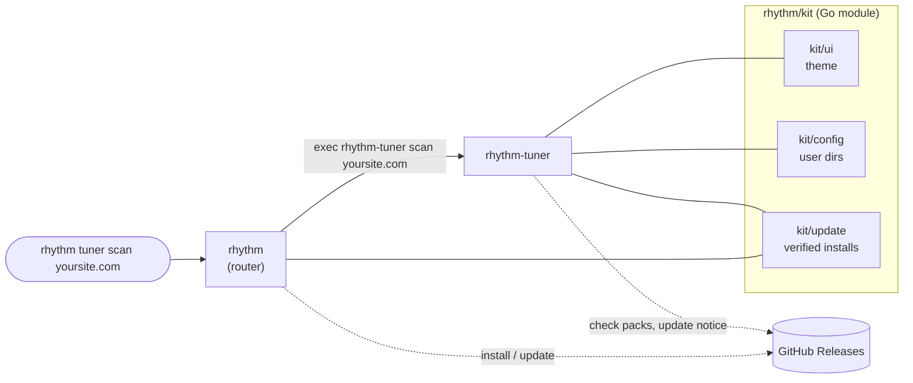
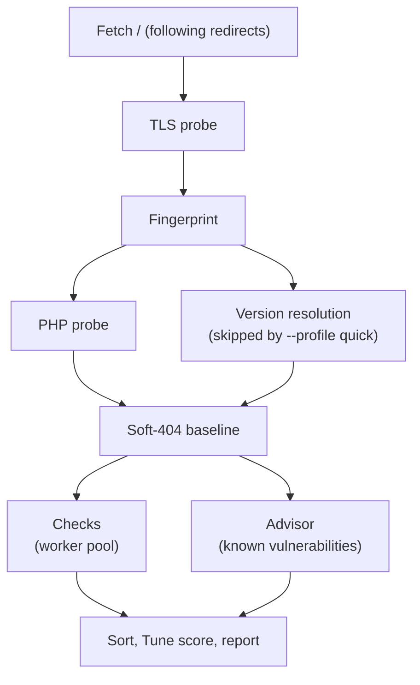

How Rhythm fits together: a small router CLI, a shared kit, and tools that live in their own repositories and release on their own. The second half walks through Tuner's internals, from the first request of a scan to the report.

## The big picture



| Piece | Repository | Role |
|---|---|---|
| `rhythm` | [`RhythmShahriar/rhythm`](https://github.com/RhythmShahriar/rhythm) | Router CLI, `install`, `update`, install scripts |
| `kit/` | same repository, module `github.com/RhythmShahriar/rhythm` | Shared base every tool imports |
| `rhythm-tuner` | [`RhythmShahriar/tuner`](https://github.com/RhythmShahriar/tuner) | WordPress & PHP security scanner |
| Shared workflows | [`RhythmShahriar/.github`](https://github.com/RhythmShahriar/.github) | Reusable CI, commit lint and release workflows, community files |

## The router

`rhythm` is deliberately thin. It follows the same extension model as `git` and `gh`:

- `rhythm <tool> [args]` looks up `rhythm-<tool>` on your `PATH` and runs it with the remaining arguments, passing stdin, stdout and stderr straight through. The tool's exit code becomes `rhythm`'s exit code, so `rhythm tuner scan … --fail-on high` works in CI exactly like `rhythm-tuner scan … --fail-on high`.
- **Aliases** are short names: `t` → `tuner`. They work for running and for `rhythm install`.
- If the binary isn't found, a known tool gets `rhythm: tuner isn't installed` with the install command; an unknown name gets `rhythm: unknown tool "<name>"`.
- `rhythm` handles four commands itself: `help`, `version`, `install <tool> [--dir]` and `update [--check]`. Anything else is treated as a tool name.

The router knows which tools exist, and which GitHub repository each comes from, through a small table in [`cmd/rhythm/main.go`](https://github.com/RhythmShahriar/rhythm/blob/master/cmd/rhythm/main.go). `rhythm update` uses it to find installed tools on the `PATH`, update each binary, then run `rhythm-<tool> update` so each tool refreshes its own data. See [Updating](Updating).

## The kit

`kit/` is a Go module every tool imports, so every tool looks the same and installs and updates the same way.

| Package | What it provides |
|---|---|
| `kit` | `Banner`, the standard header line: `♪ rhythm tuner  0.3.1` |
| `kit/ui` | The terminal theme, built from the Rhythm brand tokens: **Ink** `#100F0D`, **Paper** `#FFFFFF`, and one signal color, **Dot** `#FF7C52` (a deeper `#E8603A` on light backgrounds). Severities use conventional colors: critical red, high orange, medium yellow, low blue, ok green, muted gray. Built on Lip Gloss. |
| `kit/config` | The per-user config directory (`~/.config/rhythm` or the OS equivalent), and `FirstRun`, which records one-time notices such as Tuner's responsible-use note |
| `kit/update` | Finding the latest GitHub release, comparing semantic versions, downloading the `<binary>_<os>_<arch>` archive, verifying it against `checksums.txt`, and swapping the binary atomically. Also the once-a-day update check, which honors `RHYTHM_NO_UPDATE_CHECK` and `CI`. |

`kit/update` relies on a naming contract with every repository's GoReleaser config; see [Release Process](Release-Process#the-naming-contract).

## Independent releases

Each tool is its own repository, with its own version numbers, changelog and release cadence. A Tuner release doesn't need a `rhythm` release, and the other way round. They share:

- the release workflow and GoReleaser layout, so every release has the same archive names, `checksums.txt` and cosign signature;
- the kit, pinned by version in each tool's `go.mod`.

When a kit change is needed by a tool, `rhythm` is released first and the tool bumps its requirement; see [Release Process](Release-Process#when-the-kit-changes). For local development the repositories sit side by side, linked by a `go.work` file; see [Contributing](Contributing#set-up).

## Inside Tuner

```text
tuner/
├── cmd/rhythm-tuner   CLI: flags, check selection, picker, output wiring, update
├── engine             runs a scan: requests, rate limiting, baselines, checks, score
├── fingerprint        identifies the platform from the home page
├── matchers           evaluates a check's conditions; finds and masks secrets
├── checks             the built-in YAML checks and fixtures, embedded in the binary
├── checkpack          downloads, verifies and loads check packs
├── vulns              vulnerability data client, cache and the advisor
├── local              white-box scans of a directory on the server
└── report             terminal view, JSON, JSONL, SARIF, Markdown, baselines
```

### A remote scan, step by step



1. **Home page.** The engine fetches `/`, following redirects. That response is shared by every check that requests `/`.
2. **TLS probe.** On `https`, it inspects the handshake: certificate expiry, whether the chain and hostname verify, and whether the server still accepts TLS 1.0 or 1.1.
3. **Fingerprint.** From the home page, it identifies the platform (`wordpress`, `laravel`, `php`), the web server and any versions the page reveals.
4. **PHP probe and version resolution**, run concurrently. If the home page didn't state the PHP version, for example because a page cache stripped `X-Powered-By`, it asks up to three uncacheable endpoints. Version resolution reads WordPress core, plugin and theme versions (up to 50 components) from places like the feed generator, plugin `readme.txt` and theme stylesheets. Quick scans skip resolution but keep the PHP probe.
5. **Soft-404 baseline.** It requests a random path to learn whether the server answers `200` for pages that don't exist. During checks, a hit on a path like `/.env` is also compared with a random path of the same shape, so catch-all servers don't produce false findings.
6. **Checks and advisor, concurrently.** A worker pool runs every selected check whose `requires` matches the fingerprint, while the advisor matches the fingerprint against known vulnerabilities. Findings stream to the terminal as they're found.
7. **Finish.** Findings are sorted by severity, confirmed before *likely*, and the Tune score is computed.

All requests go through one session per target: a rate limiter that spaces requests evenly (5 per second by default) and halves the pace when the server answers `429` or `503`, down to one request every two seconds; retries that honor `Retry-After` (up to 30 seconds); a per-path response cache so no URL is fetched twice; and a client that never follows redirects for checks. Responses are capped at 1 MiB for matching. Several targets scan in parallel (`--parallel`, default 4), each with its own session and limits. See [Requests](Tuner-Requests).

### Checks and matchers

A check is declarative YAML: an ID, severity, profile, tags, optional `requires`, a GET request for one or more paths, and a `match` block. The `matchers` package evaluates each condition against the response: status, body regex and words, magic bytes, headers, cookies and their flags, scheme, TLS state, and `not_baseline`. Evidence is redacted before it leaves the engine, and `extract.secrets` reports credentials only in masked form.

Built-in checks are embedded in the binary from `checks/`. Unknown fields are rejected when checks load, which is also how an older binary refuses a check pack it can't run. See [Writing Checks](Tuner-Writing-Checks).

### Vulnerability data

The `vulns` client fetches advisories from WPVulnerability, latest-release and status data from the wordpress.org API, and PHP's supported branches from php.net. Every record is cached as a JSON file under `~/.cache/rhythm/tuner/vulns` (or the OS equivalent):

- fresh records (under 24 hours old) are used as is;
- older ones are re-fetched when a scan needs them, and if that fails the stale copy is used with a warning;
- `--offline` uses the cache only, however old;
- requests to the data services are paced (200 ms apart) and deduplicated within a scan.

The **advisor** turns the fingerprint into findings: known vulnerabilities in core, plugins, themes, PHP and the web server; outdated, closed and abandoned plugins; end-of-life PHP. Versions that a Linux distribution may have patched are reported as *likely*. It runs alongside the checks and goes through the same check selection. See [Known Vulnerabilities](Tuner-Known-Vulnerabilities).

### Check packs

The `checkpack` client lets checks update like data. At most once a day it fetches the `checks-latest` release's manifest, `checks-sha256.txt` and `checks.tar.gz`, verifies the checksums, unpacks the archive in memory with strict limits, and loads the checks with the same strict loader as built-in checks. A pack replaces the built-in checks only when it was built from a later commit and its `min_tuner` allows this binary. Any failure falls back to the cached or built-in checks with a warning. See [Check Packs](Tuner-Check-Packs).

### Local mode

When the target is a directory, Tuner runs the `local` package instead of the HTTP engine. It reads exact versions from disk (WordPress core, plugin and theme headers, `composer.lock`) and PHP from the `php` binary, reviews `wp-config.php`, flags files that don't belong in a web root, matches Composer packages against OSV.dev, and then runs the same advisor. It only reads files, never runs site code, and stops walking after 250,000 entries. See [Local Scans](Tuner-Local-Scans).

### Reports

The `report` package renders one result model several ways:

| Renderer | Used for |
|---|---|
| Pretty | The live terminal view, styled with the kit theme; `--plain` drops color, boxes and glyphs |
| JSON | `--json`, the documented report schema (an array for several targets) |
| JSONL | `--jsonl`, one finding per line as it's found |
| SARIF 2.1.0 | `--sarif`, the subset GitHub code scanning reads |
| Markdown | `--md`, for issues, pull requests and client reports |
| Baseline | `--baseline`, which reads any earlier JSON report and hides findings already in it |

See [Output](Tuner-Output) and [CI](Tuner-CI).

---
<sub>← [Release process](Release-Process) · [Home](Home)</sub>
