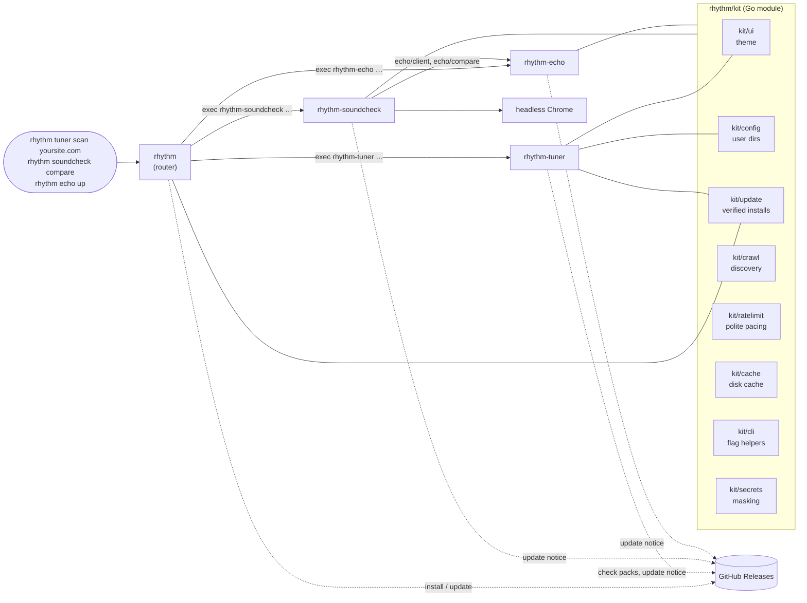
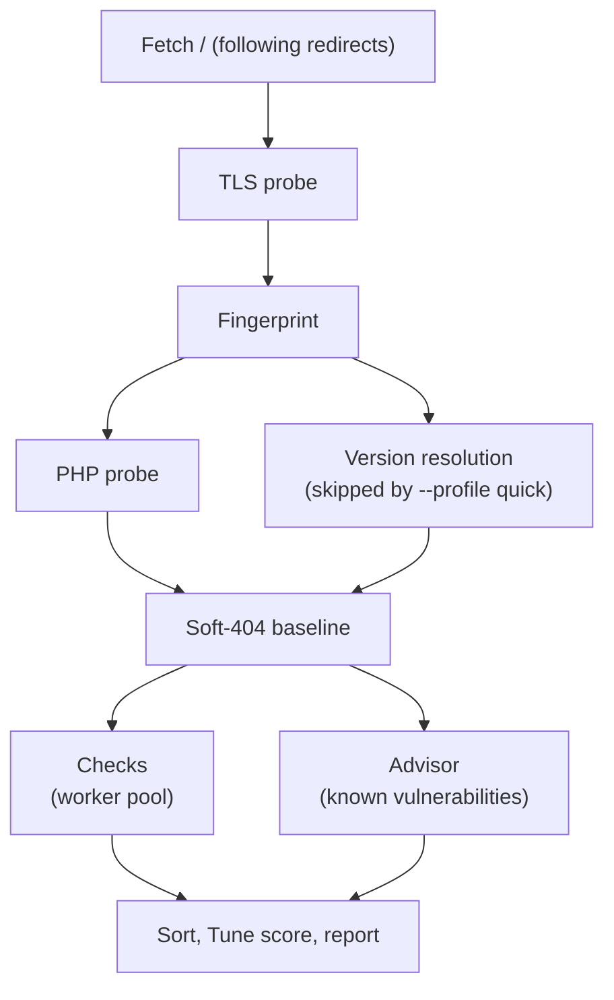
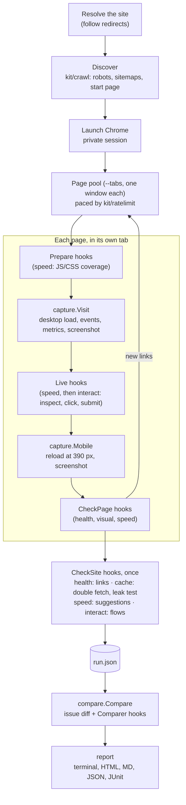
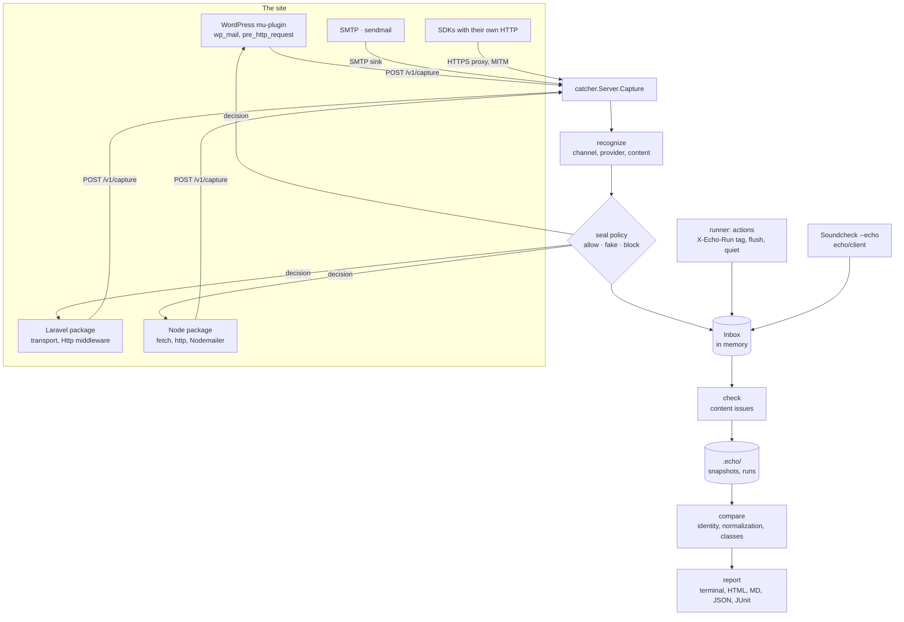

How Rhythm fits together: a small router CLI, a shared kit, and tools that live in their own repositories and release on their own. The second half walks through the internals of Tuner, from the first request of a scan to the report, of Soundcheck, from discovery to a comparison, and of Echo, from a capture to a comparison.

## The big picture



| Piece | Repository | Role |
|---|---|---|
| `rhythm` | [`RhythmShahriar/rhythm`](https://github.com/RhythmShahriar/rhythm) | Router CLI, `install`, `update`, install scripts |
| `kit/` | same repository, module `github.com/RhythmShahriar/rhythm` | Shared base every tool imports |
| `rhythm-tuner` | [`RhythmShahriar/tuner`](https://github.com/RhythmShahriar/tuner) | WordPress & PHP security scanner |
| `rhythm-soundcheck` | [`RhythmShahriar/soundcheck`](https://github.com/RhythmShahriar/soundcheck) | Whole-site before/after checks in a real browser |
| `rhythm-echo` | [`RhythmShahriar/echo`](https://github.com/RhythmShahriar/echo) | Captures and compares what a site sends; seals staging. Also publishes the npm connector `@rhythmsh/echo` |
| `rhythmsh/echo-laravel` | [`RhythmShahriar/echo-laravel`](https://github.com/RhythmShahriar/echo-laravel) | Echo's Laravel connector, split from `connectors/laravel` in the Echo repository for Packagist |
| Shared workflows | [`RhythmShahriar/.github`](https://github.com/RhythmShahriar/.github) | Reusable CI, commit lint and release workflows, community files |

## The router

`rhythm` is deliberately thin. It follows the same extension model as `git` and `gh`:

- `rhythm <tool> [args]` looks up `rhythm-<tool>` on your `PATH` and runs it with the remaining arguments, passing stdin, stdout and stderr straight through. The tool's exit code becomes `rhythm`'s exit code, so `rhythm tuner scan … --fail-on high` works in CI exactly like `rhythm-tuner scan … --fail-on high`.
- **Aliases** are short names: `t` → `tuner`, `sc` → `soundcheck`, `e` → `echo`. They work for running and for `rhythm install`.
- If the binary isn't found, a known tool gets `rhythm: tuner isn't installed` with the install command; an unknown name gets `rhythm: unknown tool "<name>"`.
- `rhythm` handles four commands itself: `help`, `version`, `install <tool> [--dir]` and `update [--check]`. Anything else is treated as a tool name.

The router knows which tools exist (`tuner`, `soundcheck` and, from rhythm v0.5.0, `echo` with its alias `e`), and which GitHub repository each comes from, through a small table in [`cmd/rhythm/main.go`](https://github.com/RhythmShahriar/rhythm/blob/master/cmd/rhythm/main.go). `rhythm update` uses it to find installed tools on the `PATH`, update each binary, then run `rhythm-<tool> update` so each tool refreshes its own data. See [Updating](Updating).

## The kit

`kit/` is a Go module every tool imports, so every tool looks the same and installs and updates the same way.

| Package | What it provides |
|---|---|
| `kit` | `Banner`, the standard header line: `♪ rhythm tuner  0.3.1` |
| `kit/ui` | The terminal theme, built from the Rhythm brand tokens: **Ink** `#100F0D`, **Paper** `#FFFFFF`, and one signal color, **Dot** `#FF7C52` (a deeper `#E8603A` on light backgrounds). Severities use conventional colors: critical red, high orange, medium yellow, low blue, ok green, muted gray. Built on Lip Gloss. |
| `kit/config` | The per-user config directory (`~/.config/rhythm` or the OS equivalent), and `FirstRun`, which records one-time notices such as Tuner's responsible-use note |
| `kit/update` | Finding the latest GitHub release, comparing semantic versions, downloading the `<binary>_<os>_<arch>` archive, verifying it against `checksums.txt`, and swapping the binary atomically. Also the once-a-day update check, which honors `RHYTHM_NO_UPDATE_CHECK` and `CI`, and `Notice`, which runs it in the background during a command. |
| `kit/crawl` | Site discovery: `robots.txt`, sitemaps (indexes, gzip) and links (or none, with `NoFollow`, for a caller that follows links itself), URL normalization (tracking parameters, trailing slashes), same-site rules, the `DefaultExcludes` for admin, login, cart and logout URLs, and grouping pages by URL pattern (`/product/{slug}`, `/?page_id={slug}`) so a large site is checked through samples. Its `Frontier` takes more pages while a browser renders them; the start page and pages listed by the user get past include, robots and grouping. |
| `kit/ratelimit` | An even request pace per host that halves after `429` or `503` (down to one request every two seconds), `Retry-After` handling up to 30 s, backoff, and `ParseTarget`, which turns `yoursite.com` or a URL into the site to check. |
| `kit/cache` | A small on-disk JSON cache with a TTL and stale fallback when the network is down, plus atomic `WriteFile` and `WriteJSON`. |
| `kit/cli` | Flag helpers shared by every tool: flags before or after positional arguments, comma-separated and repeatable list flags, usage errors that map to exit code 2, terminal detection. |
| `kit/secrets` | Finding and masking credentials in text: cloud, payment and messaging provider keys (Stripe, Twilio, SendGrid, Mailgun, Resend, Postmark, Slack webhook URLs, `whsec_` secrets…), authorization headers, URLs with credentials, secret-looking keys in config, JSON and form bodies. `Redact` masks them in place, keeping a short prefix. |

`kit/ui` also has the shared report pieces: severity badges, section rules and the summary panel. Soundcheck uses `kit/crawl`, `kit/ratelimit`, `kit/cache` and `kit/cli`; Echo uses `kit/ui`, `kit/cli`, `kit/cache`, `kit/config`, `kit/update` and `kit/secrets`; Tuner can adopt them when it moves to a newer kit.

`kit/update` relies on a naming contract with every repository's GoReleaser config; see [Release Process](Release-Process#the-naming-contract).

## Independent releases

Each tool is its own repository, with its own version numbers, changelog and release cadence. A Tuner release doesn't need a `rhythm` release, and the other way round. They share:

- the release workflow and GoReleaser layout, so every release has the same archive names, `checksums.txt` and cosign signature;
- the kit, pinned by version in each tool's `go.mod`.

When a kit change is needed by a tool, `rhythm` is released first and the tool bumps its requirement; see [Release Process](Release-Process#when-the-kit-changes). For local development the repositories sit side by side, linked by a `go.work` file; see [Contributing](Contributing#set-up).

## Inside Tuner

```text
tuner/
├── cmd/rhythm-tuner   CLI: flags, check selection, picker, output wiring, update
├── engine             runs a scan: requests, rate limiting, baselines, checks, score
├── fingerprint        identifies the platform from the home page
├── matchers           evaluates a check's conditions; finds and masks secrets
├── checks             the built-in YAML checks and fixtures, embedded in the binary
├── checkpack          downloads, verifies and loads check packs
├── vulns              vulnerability data client, cache and the advisor
├── local              white-box scans of a directory on the server
└── report             terminal view, JSON, JSONL, SARIF, Markdown, baselines
```

### A remote scan, step by step



1. **Home page.** The engine fetches `/`, following redirects. That response is shared by every check that requests `/`.
2. **TLS probe.** On `https`, it inspects the handshake: certificate expiry, whether the chain and hostname verify, and whether the server still accepts TLS 1.0 or 1.1.
3. **Fingerprint.** From the home page, it identifies the platform (`wordpress`, `laravel`, `php`), the web server and any versions the page reveals.
4. **PHP probe and version resolution**, run concurrently. If the home page didn't state the PHP version, for example because a page cache stripped `X-Powered-By`, it asks up to three uncacheable endpoints. Version resolution reads WordPress core, plugin and theme versions (up to 50 components) from places like the feed generator, plugin `readme.txt` and theme stylesheets. Quick scans skip resolution but keep the PHP probe.
5. **Soft-404 baseline.** It requests a random path to learn whether the server answers `200` for pages that don't exist. During checks, a hit on a path like `/.env` is also compared with a random path of the same shape, so catch-all servers don't produce false findings.
6. **Checks and advisor, concurrently.** A worker pool runs every selected check whose `requires` matches the fingerprint, while the advisor matches the fingerprint against known vulnerabilities. Findings stream to the terminal as they're found.
7. **Finish.** Findings are sorted by severity, confirmed before *likely*, and the Tune score is computed.

All requests go through one session per target: a rate limiter that spaces requests evenly (5 per second by default) and halves the pace when the server answers `429` or `503`, down to one request every two seconds; retries that honor `Retry-After` (up to 30 seconds); a per-path response cache so no URL is fetched twice; and a client that never follows redirects for checks. Responses are capped at 1 MiB for matching. Several targets scan in parallel (`--parallel`, default 4), each with its own session and limits. See [Requests](Tuner-Requests).

### Checks and matchers

A check is declarative YAML: an ID, severity, profile, tags, optional `requires`, a GET request for one or more paths, and a `match` block. The `matchers` package evaluates each condition against the response: status, body regex and words, magic bytes, headers, cookies and their flags, scheme, TLS state, and `not_baseline`. Evidence is redacted before it leaves the engine, and `extract.secrets` reports credentials only in masked form.

Built-in checks are embedded in the binary from `checks/`. Unknown fields are rejected when checks load, which is also how an older binary refuses a check pack it can't run. See [Writing Checks](Tuner-Writing-Checks).

### Vulnerability data

The `vulns` client fetches advisories from WPVulnerability, latest-release and status data from the wordpress.org API, and PHP's supported branches from php.net. Every record is cached as a JSON file under `~/.cache/rhythm/tuner/vulns` (or the OS equivalent):

- fresh records (under 24 hours old) are used as is;
- older ones are re-fetched when a scan needs them, and if that fails the stale copy is used with a warning;
- `--offline` uses the cache only, however old;
- requests to the data services are paced (200 ms apart) and deduplicated within a scan.

The **advisor** turns the fingerprint into findings: known vulnerabilities in core, plugins, themes, PHP and the web server; outdated, closed and abandoned plugins; end-of-life PHP. Versions that a Linux distribution may have patched are reported as *likely*. It runs alongside the checks and goes through the same check selection. See [Known Vulnerabilities](Tuner-Known-Vulnerabilities).

### Check packs

The `checkpack` client lets checks update like data. At most once a day it fetches the `checks-latest` release's manifest, `checks-sha256.txt` and `checks.tar.gz`, verifies the checksums, unpacks the archive in memory with strict limits, and loads the checks with the same strict loader as built-in checks. A pack replaces the built-in checks only when it was built from a later commit and its `min_tuner` allows this binary. Any failure falls back to the cached or built-in checks with a warning. See [Check Packs](Tuner-Check-Packs).

### Local mode

When the target is a directory, Tuner runs the `local` package instead of the HTTP engine. It reads exact versions from disk (WordPress core, plugin and theme headers, `composer.lock`) and PHP from the `php` binary, reviews `wp-config.php`, flags files that don't belong in a web root, matches Composer packages against OSV.dev, and then runs the same advisor. It only reads files, never runs site code, and stops walking after 250,000 entries. See [Local Scans](Tuner-Local-Scans).

### Reports

The `report` package renders one result model several ways:

| Renderer | Used for |
|---|---|
| Pretty | The live terminal view, styled with the kit theme; `--plain` drops color, boxes and glyphs |
| JSON | `--json`, the documented report schema (an array for several targets) |
| JSONL | `--jsonl`, one finding per line as it's found |
| SARIF 2.1.0 | `--sarif`, the subset GitHub code scanning reads |
| Markdown | `--md`, for issues, pull requests and client reports |
| Baseline | `--baseline`, which reads any earlier JSON report and hides findings already in it |

See [Output](Tuner-Output) and [CI](Tuner-CI).

## Inside Soundcheck

```text
soundcheck/
├── cmd/rhythm-soundcheck   CLI: commands, flags, picker, init, update, output wiring
├── config                  .soundcheck/config.yaml: defaults, strict loading, validation
├── runner                  one run: resolve the site, discover, visit pages in tabs, call module hooks
├── browser                 find, download and launch Chrome; private sessions
├── capture                 one page visit: events, metrics, links, text, screenshots
├── check                   the module interface: hooks and the run context
├── checks/                 the five modules
│   ├── health              status, PHP and JS errors, failed requests, links, indexing
│   ├── visual              pixel diff, dynamic regions, bands, grouping
│   ├── interact            inspect, click, submit, flows
│   ├── cache               layers, double fetch, private pages, nonces, staleness, leak test
│   └── speed               lab metrics, regressions, site-wide suggestions, plugin cost
├── flow                    the YAML flow format, its runner and fake data
├── login                   WordPress or flow login from SOUNDCHECK_USER/PASSWORD
├── compare                 two runs → ranked changes (BROKE, NEW, CHANGED, SLOWER, FIXED)
├── store                   the .soundcheck folder: snapshots, runs, LATEST, pruning, git exclude
├── report                  terminal view, plain, JSON, Markdown, JUnit, standalone HTML
├── lighthouse              hands a site to Unlighthouse for --lighthouse
└── action.yml              the GitHub Action
```

### A run, step by step



The runner knows nothing about what modules check. A module is a Go type with a `Name()` and any of these hooks, from [`check/check.go`](https://github.com/RhythmShahriar/soundcheck/blob/master/check/check.go):

| Hook | When it runs | Used by |
|---|---|---|
| `Prepare` | on a fresh tab, before it navigates | speed (starts CSS and JS coverage) |
| `Live` | while the page is open at desktop size, after the screenshot, before the mobile reload; interact runs last, since it changes the page | speed, interact |
| `CheckPage` | after the visit, on the recorded page, without the browser | health, visual (learns dynamic regions in snapshots), speed |
| `CheckSite` | once, after every page | health (links), cache, speed (suggestions), interact (flows) |
| `Compare` | in a comparison, on both runs | health (titles, content, redirects), visual, cache, speed |
| `OwnsIssues` | marks a module that diffs its own issues | speed, so lab noise doesn't flip issues between NEW and FIXED |

Each issue gets a key from its check, title and source, so `compare` can match the same problem on the same page across runs: a new error is BROKE, a new warning or notice NEW, a missing one FIXED. Comparer hooks add CHANGED and SLOWER, and the result is sorted by class and size.

### The browser layer

`browser` drives Chrome through the DevTools protocol with [go-rod](https://github.com/go-rod/rod). It uses `--browser`, or an installed Chrome or Chromium, or downloads a pinned Chromium into `<cache>/rhythm/soundcheck/browser` (progress on stderr). Chrome runs headless with GPU, audio and background networking off, with background-tab throttling disabled, and without its sandbox only when running as root. Each page gets its own window with focus emulated, so pages in parallel paint and animate like the front one, and the HTTP cache is off so every page loads cold. The crawl runs in one private (incognito) session; the leak test and each flow get their own, so a logged-in user never shares cookies with the anonymous crawl. The login is tried once at the start of a run.

`capture` records each visit from DevTools events: the document's status, headers and redirect chain; every request with its type, status, size, protocol and cache headers; console errors, uncaught exceptions and browser log errors; Web Vitals from a `PerformanceObserver` injected before any page script; the visible text, title, robots directives and same-site links. Screenshots pause animations first, and the visual module learns dynamic regions from a second capture in snapshots.

Discovery itself fetches only `robots.txt`, sitemaps and the start page (`kit/crawl` with `NoFollow`); further pages come from links in the pages the browser renders. Plain HTTP requests outside the browser (discovery, link checks, form action checks, the cache double fetch) share the run's headers, proxy, TLS settings, user agent and per-host pace.

### Storage and reports

`store` writes each run as `run.json` (schema `rhythm-soundcheck/v1`) with its screenshots, into `.soundcheck/snapshots/<name>/` or `.soundcheck/runs/<date-time>/`. A snapshot is written to `.incoming/` and moved into place only when complete. Runs are pruned to the newest 20, and the folders are added to `.git/info/exclude`. `report` renders one result model as the live terminal view, plain text, JSON, Markdown, JUnit and a standalone HTML page with embedded, scaled screenshots and the before/after slider. See [Reading results](Soundcheck-Reading-Results).

## Inside Echo

```text
echo/
├── cmd/rhythm-echo     CLI: commands, flags, up, install, doctor, check, headers, replay, output wiring
├── config              .echo/config.yaml: defaults, strict loading, validation, the init template
├── wire                the capture protocol connectors speak (Capture → Decision)
├── catcher             the running side: inbox, REST API, seal policy, SMTP sink
├── recognize           HTTP request → channel, provider, recipients, content; provider-shaped fakes
├── proxy               HTTP(S) proxy for SDKs that skip the connectors; local CA, MITM
├── sendmail            the sendmail stand-in for PHP's mail() and Unix tools
├── runner              runs actions: trigger, flush, wait for quiet, collect, check
├── check               content checks on messages (placeholders, PHP errors, SMS parts…)
├── compare             two runs → BROKE, NEW, CHANGED, FIXED, with normalization and grouping
├── replay              signed test webhooks and their safety rules; the event library
├── dns, headers        deliverability: SPF, DKIM, DMARC, MX, MTA-STS; received-mail analysis
├── store               the .echo folder: snapshots, runs, LATEST, pruning, git exclude
├── report              terminal view, plain, JSON, Markdown, JUnit, standalone HTML
├── client              Go client for the API (used by Soundcheck)
├── model               messages, actions, issues, changes (schema rhythm-echo/v1)
├── connectors/         wordpress (the mu-plugin, embedded), laravel (Composer), node (npm)
└── action.yml          the GitHub Action
```

### From a capture to a comparison



1. **Capture.** A connector inside the site reports each email and outbound HTTP request through the [capture protocol](Echo-API#the-capture-protocol), before it's sent, with the `X-Echo-Run` it found. The SMTP sink and the proxy turn what they receive into the same captures, so everything downstream treats them alike.
2. **Recognize.** `recognize` tries each provider's recognizer in turn: Twilio, Slack, SendGrid, GA4, Stripe and the rest. The first match fills the channel, provider, recipients, content and event; anything else is a generic webhook or request. Secrets are redacted with `kit/secrets` and bodies capped before the message is stored.
3. **Decide.** The seal policy answers: platform update hosts pass unrecorded; observe mode, the site's own host, loopback and the allowlist are allowed; live payment calls are blocked with the provider's own error; everything else gets the recognizer's fake. The connector does what it's told.
4. **Collect.** The inbox keeps messages in memory and wakes anything waiting on it. The runner opens an action (`/v1/actions/begin`), triggers it with its run ID, runs the flush commands, then waits until no new message has matched for the quiet time, and closes the action. Soundcheck does the same around each form submit, through `echo/client`.
5. **Check and store.** `check` runs the content checks on each action's messages. `store` writes the run as `run.json` into `.echo/snapshots/<name>/` (through `.incoming/`, moved into place when complete) or `.echo/runs/<date-time>/`, pruned to the newest 20.
6. **Compare.** `compare` matches actions by ID and messages by identity (channel and recipients for email and SMS; channel, provider, method, host, path pattern and event for the rest), normalizes test data, numbers and dates, and diffs recipients, subject, text and payload fields. Issues are diffed by key as in Soundcheck. The same change across actions is one line. `report` renders the result, and Soundcheck's `echo` module calls `compare.Messages` directly for its forms and flows.

The WordPress connector is embedded in the binary (`connectors/wordpress/echo.php`) and written by `install`. The Laravel and Node connectors are packages of their own, released with Echo; see [Release process](Release-Process#echos-packages).

---
<sub>← [Release process](Release-Process) · [Home](Home)</sub>
