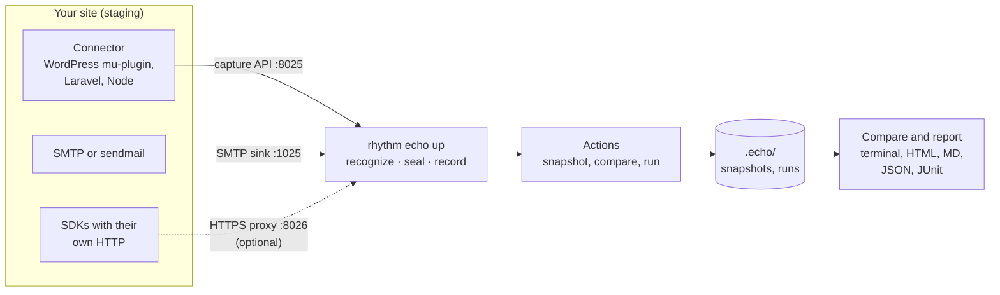

Echo answers one question: **is my site still saying what it should?** It captures every email, SMS, webhook and API call a site sends, seals staging so none of it reaches real people, and compares what each form, order or sign-up sends before and after a change. This page explains where Echo fits, what it catches, and how it works.

```sh
rhythm echo up                                   # start Echo: staging is sealed
rhythm echo install wordpress /var/www/staging   # connect the site
rhythm echo snapshot --name before-update        # what each action sends now
# …update plugins, deploy…
rhythm echo compare                              # what changed
```

Echo ships as its own binary, `rhythm-echo`, and you normally run it through `rhythm echo` (or the short alias `rhythm e`). The installer sets it up along with Tuner and Soundcheck; if you see `rhythm: echo isn't installed`, run `rhythm install echo`. See [Install](Install).

> [!IMPORTANT]
> Use Echo on sites you own or are authorized to test. Captured messages hold personal data: they stay on your machine, with credentials masked, but their content isn't. Echo seals by default; observe mode really sends. See [Responsible use](Responsible-Use).

## The Rhythm set

| Tool | Asks | Looks at |
|---|---|---|
| [Tuner](Tuner) | Is my site safe? | what an attacker can find |
| [Soundcheck](Soundcheck) | Did my change break anything? | what visitors see and do |
| **Echo** | **Is my site still saying what it should?** | **everything the site sends** |

The three work on the same change. Tuner tells you a plugin has a known vulnerability, so you update it. Soundcheck tells you the update broke the menu on 34 pages. Echo tells you the contact form still says "sent", but the office no longer gets the email. Soundcheck and Echo also work together: `rhythm soundcheck compare --echo` submits the real forms and compares what each one sent. See [With Soundcheck](Echo-With-Soundcheck).

## What it catches

| | What | Page |
|---|---|---|
| 📭 **Lost messages** | The admin notification that stopped, the autoresponder an update removed, the SMS a gateway change broke, the Slack alert, the GA4 purchase event, the webhook Zapier no longer receives, the queued mail stuck in a job. | [Actions and compare](Echo-Actions-And-Compare) |
| ✍️ **Wrong content** | Unfilled placeholders (`{first_name}`, `*\|FNAME\|*`, `[your-name]`), PHP warnings printed into emails, links to `localhost`, garbled encoding, emails Gmail clips, SMS that cost several parts, payloads that lost fields. | [Messages and checks](Echo-Messages-And-Checks) |
| 🔒 **Staging that talks to real people** | Sealed by default: email, SMS, WhatsApp, chat, webhooks, analytics and push are answered by Echo instead. Live-mode payment calls get the provider's own refusal. In observe mode, real recipients outside your allowlist are flagged. | [Sealing staging](Echo-Sealing-Staging) |
| 📬 **Deliverability** | SPF (with the 10-lookup limit), DKIM keys, DMARC policy and alignment for the service you actually send through, MX, MTA-STS, TLS-RPT and BIMI, and what a received email's headers say. Never sends anything. | [Deliverability](Echo-Deliverability) |

Echo recognizes 34 services out of the box, from SendGrid, Mailgun, Postmark, Resend and Amazon SES to Twilio, Vonage, WhatsApp Cloud, Slack, Teams, GA4, Meta, FCM, Stripe, HubSpot, Klaviyo and Zapier. Anything else is recorded as a generic webhook or request. The full list is in [Messages and checks](Echo-Messages-And-Checks#recognized-services).

## When to use it

- **On every staging site, all the time.** `rhythm echo up` with the connector installed means a staging copy of production can't email customers, text them, or post orders to the live CRM.
- **Before and after a change.** Plugin and theme updates, a new SMTP plugin, a PHP upgrade, a deploy. Snapshot what each action sends, make the change, compare.
- **For inbound webhooks.** `rhythm echo replay payment_intent.succeeded` sends a signed Stripe test event to staging and shows the order email and SMS it triggers. See [Replay](Echo-Replay).
- **For deliverability.** `rhythm echo check yoursite.com` checks the DNS records for the sender you use, on production too, since it only reads DNS.
- **In CI.** Fail a pull request when a message stops being sent. See [CI](Echo-CI).

Echo isn't a mail client renderer, a spam scorer or a general API mocking tool, and it doesn't send to real phones. Its job is what your site sends and whether that changed.

## How it works



1. **Connectors observe.** A connector lives inside the site: a WordPress mu-plugin, a Laravel package, an npm package for Next.js and Node. It hooks the mailer and the HTTP client, so it sees each message in plain text before it leaves, and reports it to Echo. For anything else, Echo has an SMTP sink, a `sendmail` stand-in and an HTTPS proxy. See [Connectors](Echo-Install-Connectors).
2. **The catcher decides.** `rhythm echo up` runs the capture API, the SMTP sink and, when asked, the proxy. Each HTTP request is recognized (a Twilio SMS, a Slack alert, a GA4 event…) and, while sealed, answered with a response shaped like the provider's, so the site carries on as if it had been sent. Emails are recorded and never delivered.
3. **An egress seal guarantees.** A connector can only see what goes through the hooks it patches. For a seal nothing can get around, run the site on an internal Docker network or behind a firewall, with Echo as its only way out. See [Sealing staging](Echo-Sealing-Staging#hard-seals).
4. **Actions make the site send.** `.echo/config.yaml` lists actions: HTTP requests (a form post), commands (`wp eval`, `php artisan`), or signed webhook replays. Each one is tagged with an `X-Echo-Run` ID, which the connector copies into every capture, so Echo knows which messages each action caused, even from queued jobs. Soundcheck can be the action runner too, submitting real forms.
5. **Compare.** A snapshot records what each action sent. `compare` runs the actions again and matches messages by who they go to and where, with test data and numbers normalized away. Missing messages are **BROKE**, new ones **NEW**, different recipients, subjects, text or payload fields **CHANGED**, and problems that went away **FIXED**. See [Actions and compare](Echo-Actions-And-Compare).

## Files

The catcher keeps captured messages in memory, up to the newest 10,000, and forgets them when it stops. Snapshots, runs and reports go to `./.echo/` in your project. Inside a git repository, `.echo/snapshots/`, `.echo/runs/` and `.echo/.incoming/` are added to `.git/info/exclude`, so captured personal data is never committed by accident, while `config.yaml` stays visible for your team. The HTTPS proxy's certificate authority lives in your cache folder (`~/.cache/rhythm/echo/ca` on Linux). See [Configuration](Echo-Configuration#the-echo-folder).

## Where to go next

| You want to… | Read |
|---|---|
| Seal a site and check a change, step by step | [Your first run](Echo-First-Run) |
| Connect WordPress, Laravel, Next.js or anything else | [Connectors](Echo-Install-Connectors) |
| Know what's caught, faked and refused | [Sealing staging](Echo-Sealing-Staging) |
| Write actions and read a comparison | [Actions and compare](Echo-Actions-And-Compare) |
| Check real forms and flows | [With Soundcheck](Echo-With-Soundcheck) |
| Wire it into CI | [CI](Echo-CI) |
| Look up a flag | [CLI reference](Echo-CLI-Reference) |
| Fix a problem | [FAQ and troubleshooting](Echo-FAQ) |

---
<sub>← [Benchmark](Soundcheck-Benchmark) · [Home](Home) · [Your first run](Echo-First-Run) →</sub>
