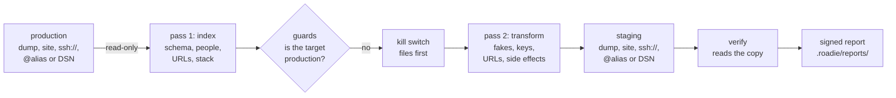

Roadie answers one question: **is my staging a safe copy of production?** It copies production to staging with every customer pseudonymised, live payment and mail keys swapped for test keys and cron, webhooks and mail turned off. Then it reads the finished copy, checks it and signs a pass or fail report. It also makes a staging copy that another tool already made safe in place. This page explains where Roadie fits, what it changes and how it works.

```sh
rhythm roadie demo                                    # a built-in shop: plan, copy, verify; no network, about a second
rhythm roadie plan --from shop.sql --to staging.sql   # every change a copy would make; nothing changes
rhythm roadie copy --from ssh://deploy@shop.com/var/www/shop --to /var/www/staging --url https://staging.shop.test
rhythm roadie prepare /var/www/staging                # make a staging that WP STAGING or a host panel made safe
rhythm roadie verify /var/www/staging                 # check any staging copy: real people, live keys, side effects
```

Roadie ships as its own binary (`rhythm-roadie`). You normally run it through `rhythm roadie` (or the short alias `rhythm ro`): `rhythm roadie` and `rhythm-roadie` are the same command. Install it with `rhythm install roadie` (rhythm v0.9.0 or later); see [Install](Install). Run `rhythm roadie` on its own in a terminal and it asks what to do: copy, prepare, verify, plan, the demo or a config file.

Generic data masking tools don't know WordPress. WordPress staging tools don't remove your customers. Roadie does both and proves it, in one free, local binary.

> [!IMPORTANT]
> Use Roadie only on sites you own or are authorised to copy. A pseudonymised copy is still personal data under the GDPR (Article 4(5), Recital 26): order totals, dates, products and anything Roadie can't recognise in free text stay. Keep copies and reports as protected as the live site. Never push a staging database back to production: its customers are fake. See [Security and limits](Roadie-Security-And-Limits) and [Responsible use](Responsible-Use).

## The Rhythm set

| Tool | Asks | Looks at |
|---|---|---|
| [Tuner](Tuner) | Is my site safe? | what an attacker can find |
| [Soundcheck](Soundcheck) | Did my change break anything? | what visitors see and do, by mouse and by keyboard |
| [Echo](Echo) | Is my site still saying what it should? | everything the site sends |
| **Roadie** | **Is my staging a safe copy of production?** | **the copy you test on** |
| [Sightread](Sightread) | What will this update really change? | the code an update brings |

They work on the same change. Tuner says a plugin needs updating and Sightread reads the update before you install it. Roadie gives you a staging copy to install it on, with no real customer in it, no live key and nothing that can send. Soundcheck shows what the update did to the pages and Echo what it did to the messages: the copy Roadie makes sends its mail to Echo. The last line of every copy suggests `rhythm echo up, then rhythm soundcheck run <url>`. `copy --soundcheck` runs Soundcheck on the copy for you.

## What it does

| | What | Page |
|---|---|---|
| 👤 **Pseudonymises people** | Users, customers, orders, addresses, comments, order notes, form entries, mail logs, Action Scheduler arguments and session data. Each real person gets one fake everywhere, inside PHP serialized and JSON values too. Fakes use reserved domains and fictional phone ranges, so they can never reach anyone. | [Pseudonymisation](Roadie-Pseudonymisation), [Profiles](Roadie-Profiles) |
| 🔑 **Swaps live keys** | Stripe, PayPal, WooPayments, Square, Braintree, Mollie, Razorpay, Adyen, Klarna, Authorize.net, Flutterwave, SendGrid, Mailgun, Postmark, SES, Twilio, Jetpack and more, in the database, `wp-config.php` and `.env`. A live key becomes the test key you set, or is blanked. WordPress salts and Laravel's `APP_KEY` are regenerated. | [Live keys](Roadie-Live-Keys) |
| 🔇 **Turns side effects off** | `WP_ENVIRONMENT_TYPE=staging`, the Echo seal for mail, WP-Cron, Action Scheduler, WooCommerce webhooks, gateways to test mode, Subscriptions staging mode, Jetpack offline, the AutomateWoo queue, Laravel's queue and mailer, plus noindex and a crawler block. | [Kill switch](Roadie-Kill-Switch) |
| 🔗 **Rewrites URLs** | Production's URL to staging's in every form (`https://`, `//`, `www.`, JSON-escaped, URL-encoded), inside serialized values with their lengths fixed. Multisite hosts by map. | [Copy and prepare](Roadie-Copy-And-Prepare#urls) |
| ✅ **Proves it** | Every copy ends with a verify that reads what was written, never what Roadie believed it changed. In exact mode it checks that no production value it replaced survives anywhere, in eight encodings. The result is a signed report anyone can check. | [Verify and reports](Roadie-Verify-And-Reports) |

Roadie knows WordPress (single and multisite), WooCommerce (legacy and HPOS), Action Scheduler, Subscriptions, AutomateWoo, Gravity Forms, WPForms, Contact Form 7 with Flamingo, Ninja Forms, Fluent Forms, MailPoet, Easy Digital Downloads, MemberPress, LearnDash, five mail logging plugins, Laravel with Cashier and any SQL schema you describe. `rhythm roadie profiles` lists them.

## When to use it

- **Before you test on a copy of production.** `copy` from a dump, a site folder, `ssh://`, a WP-CLI `@alias` or a database, to the same kinds of target. Nothing real is written to your disk on the way.
- **After WP STAGING, WP Migrate or a host panel made a staging.** `prepare` fixes it in place, after a backup.
- **After a plugin update on staging.** `prepare --only side-effects` puts the kill switch back without touching the data.
- **To check any staging, or a dump someone sends you.** `verify` looks for real-looking people, live keys, production URLs and side effects that are still on. With `--from <production dump>` it checks every real value exactly.
- **Every night in CI.** The GitHub Action refreshes staging from production, verifies it and fails the job when something is left. See [CI](Roadie-CI).
- **For an auditor or a client.** The signed report says what was checked, what wasn't and who ran it. `report check` proves it wasn't changed since.

Roadie doesn't copy files or uploads, edit web server config, clear Redis or search indexes, or block outbound traffic at the host. The plan names each of these when it applies; [Security and limits](Roadie-Security-And-Limits) lists them all.

## How it works



1. **Read production, read-only.** A site's database credentials come from `wp-config.php` or `.env`, read as text: PHP never runs. Over ssh, Roadie runs only a fixed list of read commands ([the list](Roadie-Sources-And-Targets#remote-commands)). A stream that must be read twice is spooled encrypted with a key held only in memory.
2. **Index.** Pass 1 reads the schema and every personal value, detects the stack, the profiles and production's URLs. It builds the set of real values exact mode checks for.
3. **Refuse production.** A target that matches `production:`, is the source, or says it is production is refused before anything is written. A site or database target needs a typed confirmation, or `--confirm-target` in CI.
4. **Kill switch first.** On a site target, `wp-config.php`, `.env` and the mu-plugins are written before the import starts, so nothing can send while it runs.
5. **Transform and write.** Pass 2 streams the rows through the rules to the target: a dump file written atomically, or a database import. A dump is never piped to a database client: only allowlisted statements are re-emitted ([dump safety](Roadie-Security-And-Limits#dumps-are-untrusted)).
6. **Verify.** The copy is read back and checked. The report is signed with your key and written to `.roadie/reports/`.

## Files

Roadie keeps its settings in `.roadie/config.yaml` (commit it; it never holds a secret) and writes everything else next to it: signed reports under `.roadie/reports/<UTC time>Z-<command>-<target>/`, `prepare` backups under `.roadie/backups/`, the consistency key in `.roadie/key` when you keep one and basic-auth snippets in `.roadie/basic-auth/`. Inside a git repository those four paths are added to `.git/info/exclude`. The report signing key lives in your config folder (`~/.config/rhythm/roadie/signing.key` on Linux). See [Configuration](Roadie-Configuration#files-roadie-keeps).

## Where to go next

| You want to… | Read |
|---|---|
| Try it, then make your first copy | [Getting started](Roadie-Getting-Started) |
| Understand copy, prepare and plan in detail | [Copy and prepare](Roadie-Copy-And-Prepare) |
| Copy from ssh, an alias or a database | [Sources and targets](Roadie-Sources-And-Targets) |
| See what each plugin's rule changes | [Profiles](Roadie-Profiles) |
| Know what a fake looks like and how keys work | [Pseudonymisation](Roadie-Pseudonymisation) |
| Swap live keys for test keys | [Live keys](Roadie-Live-Keys) |
| Know what is switched off and how to undo it for a test | [Kill switch](Roadie-Kill-Switch) |
| Read a verify and check a signed report | [Verify and reports](Roadie-Verify-And-Reports) |
| Copy a Laravel app, your own schema or a network | [Laravel](Roadie-Laravel), [Generic SQL and Postgres](Roadie-Generic-SQL-And-Postgres), [Multisite](Roadie-Multisite) |
| Refresh staging every night | [CI](Roadie-CI) |
| Look up a setting or a flag | [Configuration](Roadie-Configuration), [CLI reference](Roadie-CLI-Reference) |
| Know what Roadie promises and can't do | [Security and limits](Roadie-Security-And-Limits), [FAQ](Roadie-FAQ) |
| Fix an error | [Troubleshooting](Roadie-Troubleshooting) |

---
<sub>← [Benchmark](Echo-Benchmark) · [Home](Home) · [Getting started](Roadie-Getting-Started) →</sub>
