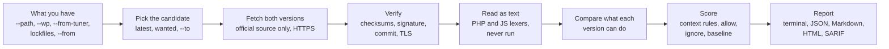

Sightread answers one question: **what will this update really change?** Read the update before you install it. Sightread diffs the version you have against the one you would get from the official source and tells you, in plain words, what is new: network calls, code execution, admin users, install scripts, a new owner. It never runs the code. This page explains where Sightread fits, what it catches and how it works.

```sh
rhythm sightread demo                          # three built-in updates, no network, a few seconds
rhythm sightread plugin akismet --from 5.3.3   # one WordPress.org plugin against the latest
rhythm sightread all /var/www/shop             # every available update in a site or project
rhythm sightread init ci                       # a GitHub workflow that reviews lockfile changes
```

Sightread ships as its own binary (`rhythm-sightread`). You normally run it through `rhythm sightread` (or the short alias `rhythm sr`): `rhythm sightread` and `rhythm-sightread` are the same command. Install it with `rhythm install sightread` (rhythm v0.9.0 or later); see [Install](Install). Run `rhythm sightread` on its own in a terminal and it shows what it found in the folder and offers the likely next step: review every update here, one plugin or theme, a lockfile change, the demo or CI.

WordPress.org plugins and themes, Composer and npm, in one local, free tool. It diffs only what changed, ranks it, explains it and keeps a review record you commit next to your code.

> [!IMPORTANT]
> A clean result is a static diff, not proof an update is safe. Sightread reports what changed; it does not judge intent. Each lookup tells the registry a package name and version you use. Reports hold your full inventory. See [FAQ and honest limits](Sightread-FAQ#honest-limits) and [Security model](Sightread-Security-Model).

## The Rhythm set

| Tool | Asks | Looks at |
|---|---|---|
| [Tuner](Tuner) | Is my site safe? | what an attacker can find |
| [Soundcheck](Soundcheck) | Did my change break anything? | what visitors see and do, by mouse and by keyboard |
| [Echo](Echo) | Is my site still saying what it should? | everything the site sends |
| [Roadie](Roadie) | Is my staging a safe copy of production? | the copy you test on |
| **Sightread** | **What will this update really change?** | **the code an update brings** |

They work on the same change. Tuner says a plugin has a known vulnerability and an update is out. Sightread reads that update before you install it: is it the same people, does it add a network call or an admin user, does the changelog say why? Roadie makes and checks the staging copy, Soundcheck shows what the update did to the pages and Echo what it did to the messages. `rhythm sightread plugin <slug> --soundcheck <staging-url>` runs the last part for you: see [With Soundcheck and Roadie](Sightread-With-Soundcheck).

## Each update gets a verdict

| Verdict | Means | Exit with `--fail-on high` |
|---|---|---|
| **HOLD** | a critical finding: don't install it before you have read it | 1 |
| **REVIEW** | a high or medium finding worth a look | 1 if high |
| **ROUTINE** | only low or info findings, or none | 0 |
| **ALLOWED** | every finding is covered by a review you recorded for these exact bytes | 0 |
| **UNVERIFIED** | Sightread couldn't check where the bytes came from, so it didn't diff them (unless `--allow-unverified`) | 3 unless `--allow-unverified` |

This is the demo's summary, three made-up updates served from memory on 127.0.0.1:

```text
  ♪ rhythm sightread 1.0.0  /tmp/sightread-demo-.../site  WordPress 6.8.3
  ────────────────────────────────────────────────────────────────────────
  Read-only. Sightread changes nothing on your site and never runs the
  code it downloads.

  VERDICT     UPDATE           FROM   TO     FINDINGS
  HOLD        date-utils-lite  1.4.0  1.4.1  1 critical, 4 high
  HOLD        share-kit        3.2.0  3.2.1  4 critical, 3 high
  ROUTINE     comment-guard    4.1.2  4.1.3
...
 ╭──────────────────────────────────────────────────────────────────────╮
 │  3 UPDATES                                       2 hold · 1 routine  │
 │  ■ 5 critical   ■ 7 high                                             │
 │  Sightread reports what changed. It does not judge intent.           │
 ╰──────────────────────────────────────────────────────────────────────╯
```

The whole run, card by card, is in [Your first review](Sightread-First-Review).

## What it catches

Sightread compares what the two versions can do, not their lines. A signal fires when a capability is in the new version and not in the old one, so reformatting, minifying and line endings stay quiet. There are 48 signals; `rhythm sightread signals` lists them and the [Signal reference](Sightread-Signal-Reference) explains each one.

| | What | Examples |
|---|---|---|
| **Bytes and where they came from** | the archive differs from the published hash, the same version has other bytes, an allowed version has a new hash, a lockfile entry moved off the registry, npm provenance dropped, no git tag for the release | `integrity-mismatch`, `version-republished`, `lockfile-source-change` |
| **Code that runs** | fetches remote code and runs it, decodes hidden code and runs it, code built at run time, large encoded blobs, `unserialize` of request or remote data, code hidden in images and fonts, Trojan Source characters | `remote-fetch-exec`, `decode-exec`, `eval-dynamic` |
| **WordPress powers** | creates or hides administrators, grants admin capabilities, blocks other updates, REST routes anyone can call, new cron tasks, content shown only to search engines | `admin-user-create`, `update-suppression`, `bot-cloaking` |
| **Data and files** | writes outside its own folder (`wp-config.php`, `.htaccess`, mu-plugins, `~/.npmrc`), reads credentials and tokens, sends site data to a new host, contacts a new domain, adds a secret (shown masked) | `write-outside-package`, `data-exfil`, `outbound-new-domain` |
| **Install time** | new npm install scripts, Composer plugins and script hooks, `autoload.files`, new dependencies, names one typo from a popular package, private names that also exist publicly | `npm-install-script-new`, `composer-plugin-new`, `typosquat` |
| **Who and when** | new owner, committer or publisher, closed on WordPress.org, released in the last 72 hours, first release after a year of silence, abandoned, license changed | `owner-change`, `fresh-release`, `dormant-release` |
| **Known records** | listed as malicious or vulnerable by [OSV](https://osv.dev) | `known-malicious`, `known-vulnerable` |
| **The archive itself** | entries that escape the package, links and special files, duplicate names, code too large or too strange to read | `archive-path-escape`, `unanalysed` |
| **Context** | a changelog that doesn't mention what the code adds, an installed copy that differs from the official one, a PHP requirement that moved, security files removed | `changelog-mismatch`, `local-drift` |

An owner change raises the code signals of the same update. Findings in tests, docs and vendored folders are lowered one level. `--min-confidence confirmed` keeps only exact patterns.

## When to use it

- **Before you click Update.** `rhythm sightread all /var/www/shop` reviews every plugin, theme, Composer and npm update a site can take, in one report. Send the HTML report to a client.
- **On every Dependabot or Renovate pull request.** `rhythm sightread changes` reviews every version a lockfile change moves; the [GitHub Action](Sightread-CI) runs it, comments on the pull request and fails it at `high`.
- **For a premium plugin.** The vendor's zip has no official source: `--to-file ~/zips/gravityforms-2.9.1.zip` diffs it anyway and marks it unverified.
- **Across an agency's sites.** `rhythm sightread all --sites sites.yaml` reviews each update once for every site; `rhythm sightread watch` does it each night and tells Slack, Discord, email or a webhook what is new. See [Watch](Sightread-Watch).
- **To record a review.** `rhythm sightread allow` binds "someone read this" to the exact archive, commits next to your code and is shared across repos. See [Allow and baseline](Sightread-Allow-And-Baseline).
- **To try the update on staging.** `--soundcheck <staging-url>` installs the verified zip on a staging copy and compares it before and after with Soundcheck.

Sightread isn't a vulnerability scanner for a whole codebase (that is Tuner), it doesn't check that a site still works (that is Soundcheck) and it doesn't prove an update is safe.

## How it works



1. **Find what is installed.** In order: `--from`, `--from-file`, the plugin header or `style.css` under `--path`, a WP-CLI command (`--wp`), a Tuner report (`--from-tuner`) or the lockfile (`composer.lock`, `npm-shrinkwrap.json`, `package-lock.json`, `pnpm-lock.yaml`, `yarn.lock`, `bun.lock`).
2. **Pick the candidate.** WordPress plugins and themes go to `latest`, what WordPress offers. Composer and npm go to `wanted`, the newest version your `composer.json` or `package.json` range allows; the header says when a newer one is outside it.
3. **Fetch and verify.** Both versions come from the official source only, over HTTPS, with a fixed host allowlist on every redirect. Bytes are diffed only after they match what the source publishes. The report says what "verified" meant for each source; see [Sources and integrity](Sightread-Sources-And-Integrity).
4. **Read, never run.** Archives go into a content-addressed store and are never unpacked under their own names. PHP and JS lexers extract what each version can do: calls, hosts, hooks, capabilities, cron tasks, write targets, decode chains, encoded blobs, install scripts.
5. **Compare and rank.** A detector fires on a capability present in the new version and absent in the old one. The scorer applies the context rules, your allow entries, ignore rules and baseline, then gives each update its verdict.

## Files

| Where | What |
|---|---|
| `.sightread/config.yaml` | the project's settings; commit it. See [Configuration](Sightread-Configuration). |
| `.sightread/allowed.yaml` | the versions someone reviewed, bound to their hash; commit it and protect it with CODEOWNERS |
| `~/.cache/rhythm/sightread` (Linux) | downloaded archives, metadata and the last reports, mode 0700; `rhythm sightread cache prune` trims it |
| `~/.config/rhythm/sightread/report-key` | the Ed25519 key `--sign` creates on first use, mode 0600 |

Reports are written readable by you only (mode 0600). With `CI` set, paths in them are relative (`--redact-paths`).

## Where to go next

| You want to… | Read |
|---|---|
| Try it, then review one plugin and a whole site | [Your first review](Sightread-First-Review) |
| Know what a finding means and how to review it | [Signal reference](Sightread-Signal-Reference) |
| Record that you reviewed a version | [Allow and baseline](Sightread-Allow-And-Baseline) |
| Know what "verified" proves for each source | [Sources and integrity](Sightread-Sources-And-Integrity) |
| Install an update on staging and compare before and after | [With Soundcheck and Roadie](Sightread-With-Soundcheck) |
| Review many sites each night | [Watch](Sightread-Watch) |
| Gate pull requests | [CI and the GitHub Action](Sightread-CI) |
| Set defaults for a project | [Configuration](Sightread-Configuration) |
| Read or render JSON, Markdown, HTML and SARIF | [Output and reports](Sightread-Output) |
| Know what Sightread contacts, runs and writes | [Security model](Sightread-Security-Model) |
| Look up a flag or an exit code | [CLI reference](Sightread-CLI-Reference) |
| Fix a problem or read the limits | [FAQ and honest limits](Sightread-FAQ) |
| See how it was measured | [Benchmark](Sightread-Benchmark) |

---
<sub>← [Benchmark](Roadie-Benchmark) · [Home](Home) · [Your first review](Sightread-First-Review) →</sub>
