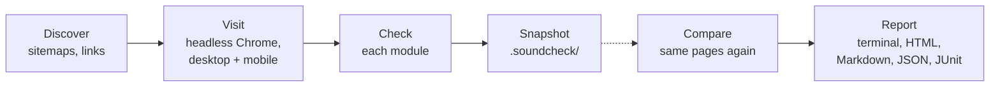

Soundcheck answers one question: **did my change break anything?** You snapshot a whole site, update a plugin, switch PHP or deploy, then compare. Soundcheck shows only what's different, most serious first. This page explains what it checks, when to use it and how a run works.

```sh
rhythm soundcheck snapshot staging.yoursite.com   # before
# …update plugins, switch PHP, deploy…
rhythm soundcheck compare                         # after
```

Soundcheck ships as its own binary, `rhythm-soundcheck`. You normally run it through `rhythm soundcheck` (or the short alias `rhythm sc`). The installer sets it up along with Tuner; if you see `rhythm: soundcheck isn't installed`, run `rhythm install soundcheck`. See [Install](Install).

> [!IMPORTANT]
> Check only sites you own or have permission to test. Soundcheck browses like a visitor at a polite pace. It only submits forms when you turn on the `submit` level. It refuses to on sites you list as production. See [Responsible use](Responsible-Use).

## What it checks

Soundcheck opens every page in headless Chrome (or [Firefox or WebKit](Soundcheck-Browsers)), at desktop and phone size. It runs five modules on each page by default and more when you ask.

| Module | What it looks for | Page |
|---|---|---|
| 🩺 **health** | Server errors and 404s, PHP fatals, warnings, notices and deprecations with file and line, the WordPress "critical error" screen, white screens, framework error pages, JavaScript errors, failed XHR, REST and `admin-ajax` calls, broken links and assets, mixed content, lost titles, a new `noindex`. | [Page health](Soundcheck-Page-Health) |
| 🖼️ **visual** | Full-page screenshots, compared pixel by pixel. Regions that change on their own (sliders, clocks, ads) are learned and ignored. A change shared by many pages is reported once. | [Visual changes](Soundcheck-Visual) |
| 🖱️ **interact** | Forms and controls read from the page, then menus, tabs, accordions and modals clicked to find **dead clicks** and clicks that throw. Opt in to submit forms with test data and to run your own YAML flows. | [Interactions](Soundcheck-Interactions), [Forms and flows](Soundcheck-Forms-And-Flows) |
| 🗄️ **cache** | Which cache layer serves pages and how often, private pages (cart, checkout, account) served from cache, logged-in content leaking to visitors, cached pages carrying expired WordPress nonces, stale copies. | [Cache](Soundcheck-Cache) |
| ⚡ **speed** | Lab LCP, CLS, TBT, TTFB, weight and requests per page; slowdowns past a noise floor; site-wide suggestions grouped by cause, including what each plugin costs. | [Speed](Soundcheck-Speed) |
| ♿ **a11y** (off by default, on with `--eaa`) | axe-core's WCAG 2.1 A and AA rules on every page (2.0 or 2.2 with `--wcag`): missing labels, alt text, contrast; plus fields labeled only by a placeholder, reflow at 320 px and overlay widgets. | [Accessibility and SEO](Soundcheck-Accessibility-And-SEO) |
| ⌨️ **keyboard** (off by default, on with `--eaa`) | Tab and Shift+Tab through every page, then menus and dialogs by keyboard: keyboard traps, focus lost or invisible, skip links that go nowhere, controls only a mouse can use. Key flows replay a checkout with keys only. | [Keyboard walkthrough](Soundcheck-Keyboard-Walkthrough) |
| 🔎 **seo** (off by default) | What search engines read: a new `noindex`, a lost canonical, robots.txt or the sitemap broken, Open Graph and structured data gone. | [Accessibility and SEO](Soundcheck-Accessibility-And-SEO#seo) |
| ✉️ **echo** (with `--echo`) | The emails, SMS and webhooks each form submit sends, through [Echo](Echo). | [With Soundcheck](Echo-With-Soundcheck) |
| ⚙️ **exec** (when configured) | Your own program on every page, plus your own [error rules](Soundcheck-Error-Rules) in YAML. | [Error rules and exec](Soundcheck-Error-Rules) |

Soundcheck is built for PHP and WordPress (it knows plugin paths, nonces, form plugins and cache plugins) and works on any site.

## When to use it

- **Before and after a change.** Plugin and theme updates, a WordPress or PHP upgrade, a new cache rule, a deploy. Take a snapshot, make the change, compare.
- **Staging against production.** `rhythm soundcheck staging.yoursite.com --against yoursite.com` checks both now and compares them, with no snapshot.
- **In CI.** Fail a pull request or a deploy when something broke. See [CI](Soundcheck-CI).
- **A one-off health check.** `rhythm soundcheck run yoursite.com` lists the problems a site has right now.
- **Plugin updates on WordPress.** `rhythm soundcheck wp-update` updates the plugins one by one (or by halves) and names the one that breaks the site. See [WordPress updates](Soundcheck-WP-Update).
- **Accessibility evidence for the European Accessibility Act.** `rhythm soundcheck snapshot staging.yoursite.com --eaa` runs the a11y and keyboard modules, drafts an accessibility statement and keeps an evidence pack you can sign; later compares show only new accessibility problems. Evidence, not a compliance guarantee. See [EAA mode](Soundcheck-EAA).
- **Many client sites.** `rhythm soundcheck fleet sites.yaml compare` checks them all and ranks them worst first; `report --client` writes a branded report. See [Fleet and client reports](Soundcheck-Fleet-And-Client-Reports).

Soundcheck isn't a security scanner; that's [Tuner](Tuner). The two complement each other: Tuner looks for what an attacker could use, Soundcheck for what your last change did to visitors.

## How a run works



1. **Discover.** Soundcheck fetches the start page (following redirects, so http becomes https and apex becomes www when the site says so), reads `robots.txt` and the sitemaps and follows the links it finds in each page the browser renders. Pages that share a URL pattern, such as `/product/{slug}/`, are grouped. A few samples stand for the rest. Admin, login, feeds and URLs with side effects (log out, add to cart) are never visited. See [Discovery](Soundcheck-Discovery).
2. **Visit.** Each page opens in its own background window of a private browser session (like a private window, never logged in), eight at a time and at most 5 page loads a second, with the browser's cache off so every page loads cold. Soundcheck records the response, redirects, console errors, failed requests, every resource, lab timings and the visible text, then takes a full-page screenshot. The page then reloads at phone size (390 px wide) for a second screenshot.
3. **Check.** While the page is open, the interact module reads its forms and clicks its controls; links in the rendered page join the queue. Then every module checks the recorded page. After the last page, site-wide checks run: links to pages that weren't visited, the cache double fetch and leak test, speed suggestions and your flows.
4. **Snapshot.** `snapshot` saves the run (`run.json`, its pages and the screenshots) in `.soundcheck/snapshots/<name>/`, with its own `report.html`. A snapshot takes each screenshot twice, a moment apart, to learn the regions that change on their own. A stopped snapshot can carry on with `--resume`.
5. **Compare.** `compare` checks the snapshot's pages again, with the snapshot's settings and no new discovery, then diffs the two runs. New errors become **BROKE**, other new problems **NEW**, visual and content differences **CHANGED**, slowdowns **SLOWER** and problems that went away **FIXED**. Pages with a BROKE or NEW change are visited once more: a problem that doesn't come back is **UNSTABLE**, not a failure. Changes you expected can be [accepted into the snapshot](Soundcheck-Review-And-Accept).
6. **Report.** The terminal shows the result live. Every run also writes a standalone `report.html` with before/after sliders. You can also save Markdown, JSON or JUnit. See [Reading results](Soundcheck-Reading-Results).

With every module on, a 37-page local test site took 54 s for the snapshot and 47 s for the compare; a 101-page static site on a 16-core machine took 92 s and 61 s. Large sites stay manageable because grouping caps how many pages of each pattern are checked; see [FAQ](Soundcheck-FAQ#slow-or-huge-sites).

## The browser

Soundcheck drives Chrome or Chromium through the DevTools protocol. It uses an installed Chrome when it finds one. Otherwise it downloads Chrome for Testing once, on first use, into your cache folder, checked against a SHA-256 pinned in the binary. `rhythm soundcheck update` installs or refreshes it; `--browser` points at a specific binary, or at `firefox` or `webkit` ([Firefox and WebKit](Soundcheck-Browsers)). See [FAQ](Soundcheck-FAQ#chromium-download-and-update).

## Files

Everything Soundcheck records stays in your project, in `./.soundcheck/`: snapshots, recent runs and comparisons, screenshots, reports and a history of every result ([History](Soundcheck-History)). Inside a git repository, the snapshots and runs are added to `.git/info/exclude` so screenshots are never committed by accident, while `config.yaml`, `flows/` and `rules/` stay visible for your team. See [Configuration](Soundcheck-Configuration#the-soundcheck-folder).

## Where to go next

| You want to… | Read |
|---|---|
| Take a snapshot and compare, step by step | [Your first check](Soundcheck-First-Check) |
| Understand BROKE, NEW, CHANGED, SLOWER, FIXED and UNSTABLE | [Reading results](Soundcheck-Reading-Results) |
| Accept or ignore expected changes | [Review and accept](Soundcheck-Review-And-Accept) |
| Control which pages are checked | [Discovery](Soundcheck-Discovery) |
| Test forms and scripted journeys | [Forms and flows](Soundcheck-Forms-And-Flows) |
| Check caching and logged-in leaks | [Cache](Soundcheck-Cache) |
| Gather accessibility evidence for the EAA | [EAA mode](Soundcheck-EAA) |
| Wire it into CI | [CI](Soundcheck-CI) |
| Compare every pull request with `main` and comment on it | [CI baselines and PR comments](Soundcheck-CI-Baselines) |
| Update WordPress plugins safely | [WordPress updates](Soundcheck-WP-Update) |
| Check many sites, send clients a report | [Fleet and client reports](Soundcheck-Fleet-And-Client-Reports) |
| Move over from BackstopJS or Lost Pixel | [Import](Soundcheck-Import) |
| Change defaults for a project | [Configuration](Soundcheck-Configuration) |
| Look up a flag | [CLI reference](Soundcheck-CLI-Reference) |
| Fix a problem | [FAQ and troubleshooting](Soundcheck-FAQ) |

---
<sub>← [FAQ and troubleshooting](Tuner-FAQ) · [Home](Home) · [Your first check](Soundcheck-First-Check) →</sub>
